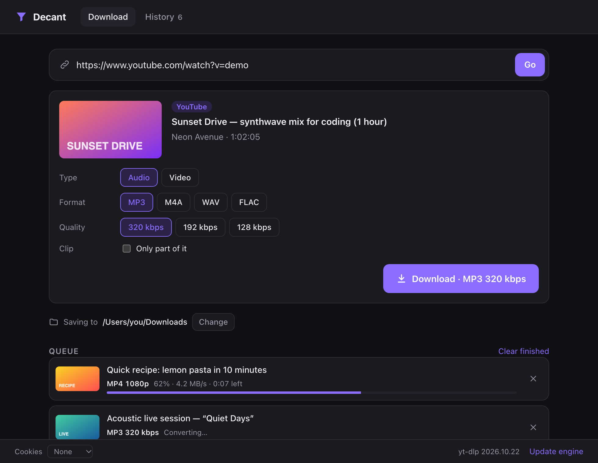
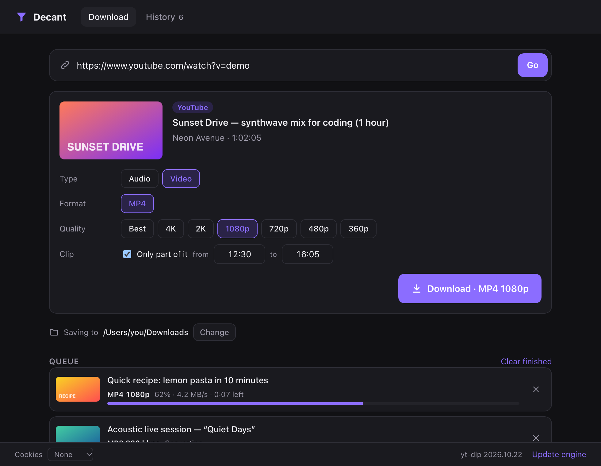
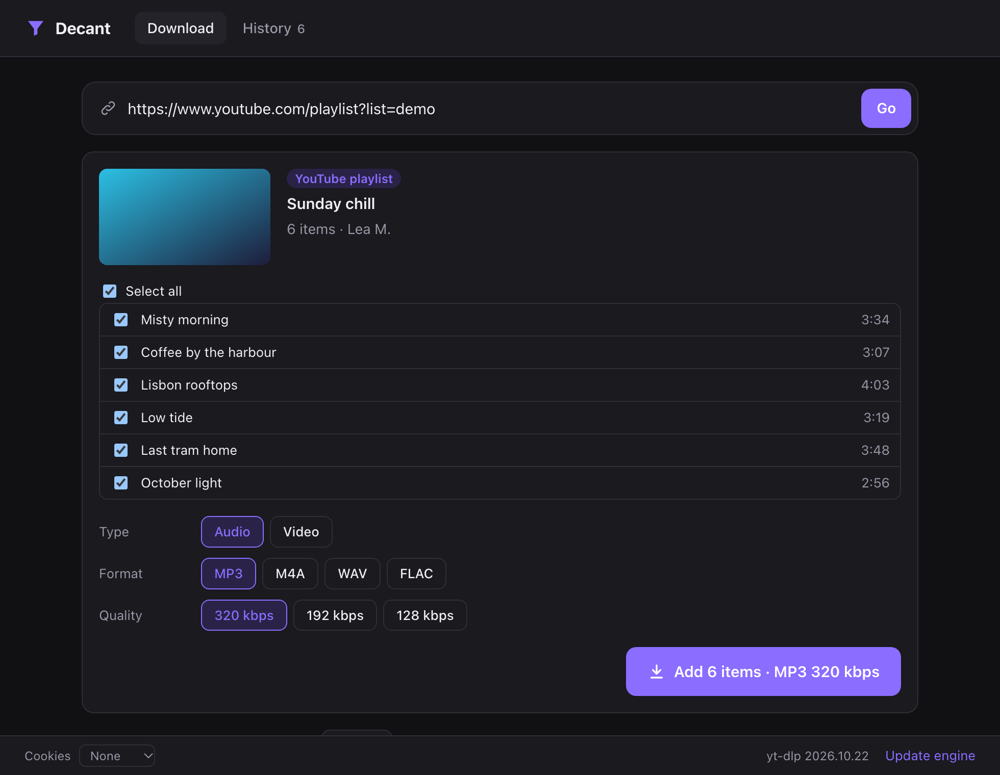

<div align="center">


# Decant

**Paste a link, pick audio or video, done.**
Download from YouTube, Instagram, TikTok and 1,000+ other sites — on Mac and Windows. No ads, no account, no limits.

[](https://github.com/m1shko/decant/actions/workflows/build.yml)
[](https://github.com/m1shko/decant/releases/latest)

[](LICENSE)

[**Download**](#-install) · [Features](#-features) · [FAQ](#-faq) · [Development](#%EF%B8%8F-development)

<br />



</div>

## ✨ Features

|                         |                                                                                                       |
| ----------------------- | ----------------------------------------------------------------------------------------------------- |
| 🎵 **Audio**             | MP3 (320 / 192 / 128 kbps), M4A (original audio, no quality loss), WAV, FLAC                          |
| 🎬 **Video**             | MP4 from 360p to 4K, using H.264 whenever possible so it plays everywhere (QuickTime, Windows, phones) |
| ✂️ **Clips**             | Grab just a part: "from 12:30 to 16:05"                                                                |
| 📃 **Playlists**         | Tick the items you want, they go straight to the queue                                                 |
| ⏬ **Queue**             | Line up as many downloads as you like, two run at once, with speed and time left                       |
| 🖼️ **Cover art & tags**  | Title, artist and thumbnail embedded in the file, so your music library stays tidy                     |
| 📋 **Auto-paste**        | Copy a link in your browser, switch to Decant: it is already loaded. Drag and drop works too           |
| 🔎 **Search**            | No link? Type a few words and Decant searches YouTube                                                  |
| 🕘 **History**           | Find, open or re-download anything you got before                                                      |
| 🍪 **Browser cookies**   | Uses your browser session for Instagram, private or age-restricted videos                              |
| 🔄 **Always up to date** | The download engine updates itself daily, because sites change all the time                           |

<div align="center">


</div>

## 📦 Install

Head to [**Releases**](https://github.com/m1shko/decant/releases/latest) and grab the file for your computer:

| System                               | File                            |
| ------------------------------------ | ------------------------------- |
| macOS (Apple Silicon: M1, M2, M3…)    | `Decant-x.y.z-arm64.dmg`        |
| Windows 10 / 11 (installer)           | `Decant.Setup.x.y.z.exe`        |
| Windows (portable, no install)        | `Decant.x.y.z.exe`              |

Nothing else to install: everything Decant needs is bundled.

> [!NOTE]
> **First launch on macOS:** go to **System Settings → Privacy & Security**, scroll down and click **Open Anyway** next to Decant.
>
> **On Windows:** click **More info → Run anyway** on the SmartScreen window.

## 🚀 How to use it

1. **Copy a link** (YouTube video, Instagram Reel, TikTok, playlist…) and paste it into Decant. If Decant is already open, the link shows up by itself.
2. **Choose** *Audio* or *Video*, then the format and quality. Tick *Only part of it* to keep just a clip.
3. **Click Download.** The file lands in your *Downloads* folder (switch it with the **Change** button right under the preview).

## ❓ FAQ

<details>
<summary><b>Which sites work?</b></summary>

YouTube (videos, Shorts, playlists), Instagram (Reels, posts), TikTok, X/Twitter, Facebook, Vimeo, Dailymotion, Twitch, SoundCloud… and [over a thousand more](https://github.com/yt-dlp/yt-dlp/blob/master/supportedsites.md), since Decant is built on yt-dlp.
</details>

<details>
<summary><b>Instagram (or YouTube) asks me to log in</b></summary>

Some content is only visible when you are logged in. At the bottom of the window, set **Cookies** to the browser you are logged in with (Chrome, Firefox, Safari, Edge…). Decant then uses your session, just as if you were watching in that browser. Nothing is sent anywhere else.

On macOS, Chrome may ask for Keychain access (click *Always Allow*), and Safari needs **Full Disk Access** for Decant (System Settings → Privacy & Security).
</details>

<details>
<summary><b>My 4K video won't open in QuickTime</b></summary>

Above 1080p, YouTube only offers VP9 or AV1. The MP4 plays fine in [VLC](https://www.videolan.org/) or [IINA](https://iina.io/), and in QuickTime on recent Macs. At 1080p and below, Decant picks H.264, which plays everywhere.
</details>

<details>
<summary><b>MP3, M4A, WAV or FLAC?</b></summary>

- **MP3 320 kbps**: the default, plays everywhere.
- **M4A**: the audio exactly as the site streams it, no re-encoding. Smaller than MP3 and just as good.
- **FLAC / WAV**: lossless formats, handy for editing or DJing. Note that they can't sound better than the source.
</details>

<details>
<summary><b>A download fails that used to work</b></summary>

Sites change regularly. Decant updates its engine once a day, but you can force it with **Update engine** in the bottom right corner. If it still fails, [open an issue](https://github.com/m1shko/decant/issues) with the link and the error message.
</details>

<details>
<summary><b>What about Intel Macs or Linux?</b></summary>

There is no ready-made build yet, but Decant runs from source (see below), and `npm run dist:mac` on an Intel Mac produces an Intel build.
</details>

## 🛠️ Development

Decant is an [Electron](https://www.electronjs.org/) app that drives [yt-dlp](https://github.com/yt-dlp/yt-dlp) to fetch media and [FFmpeg](https://ffmpeg.org/) to convert it.

```bash
git clone https://github.com/m1shko/decant.git
cd decant
npm install   # also fetches yt-dlp, ffmpeg and ffprobe into bin/
npm start     # run the app
npm test      # unit tests
```

Build the app:

```bash
npm run dist:mac   # → dist/Decant-x.y.z-arm64.dmg  (on a Mac)
npm run dist:win   # → dist/Decant Setup x.y.z.exe  (on Windows)
```

Every push to `main` builds both versions with GitHub Actions (*Actions* tab → artifacts). Pushing a `vX.Y.Z` tag publishes a release.

```
src/
├── main/        main process: download queue, yt-dlp calls, settings
├── preload.js   safe bridge between the interface and the main process
└── renderer/    interface (plain HTML, CSS and JS, no framework)
```

The screenshots in this README are generated with `node scripts/screenshots.mjs`.

## ⚖️ Use it responsibly

Decant is meant for content you are allowed to keep: your own videos, public domain or Creative Commons works, or a private copy where the law in your country allows it. Respect copyright and each site's terms of service. Decant is not affiliated with any of the sites mentioned.

## 🙏 Credits

All the hard work is done by [yt-dlp](https://github.com/yt-dlp/yt-dlp) and [FFmpeg](https://ffmpeg.org/). Thanks to their contributors.

## License

[MIT](LICENSE) © m1shko

<p align="center"><sub>Made with <a href="https://claude.ai">Claude</a></sub></p>
