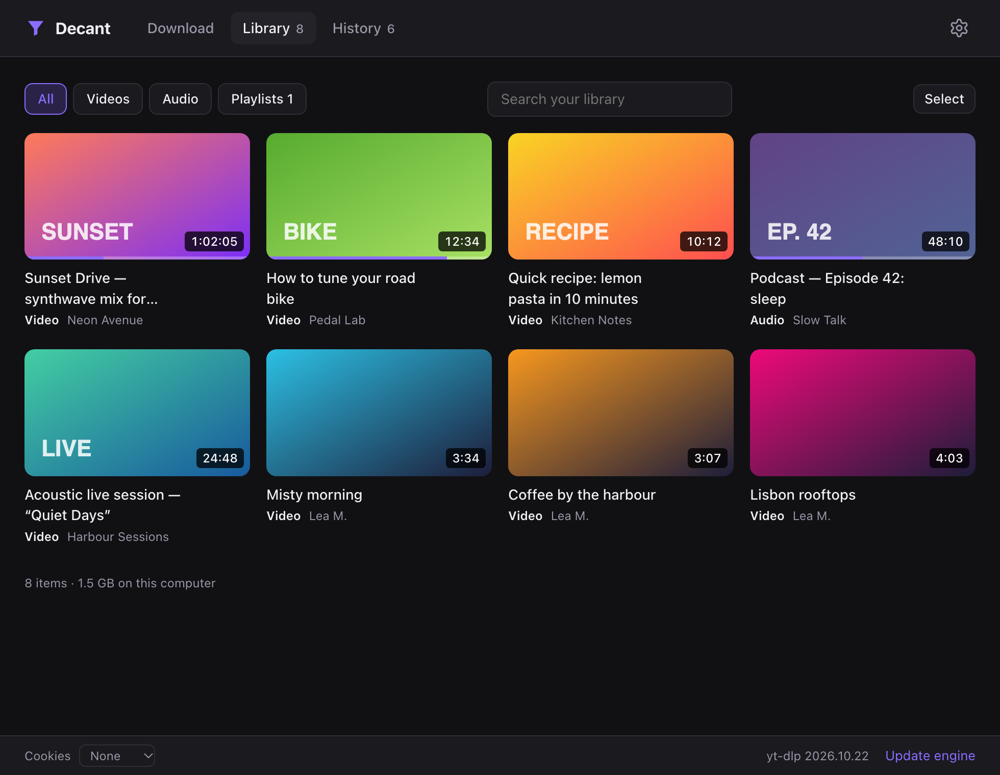

<div align="center">


# Decant

**Paste a link, pick audio or video, done.**
Download from YouTube, Instagram, TikTok and 1,000+ other sites, or save videos to Decant's own library and watch them offline — on Mac, Windows and Linux. No ads, no account, no limits.

[](https://github.com/m1shko/decant/actions/workflows/build.yml)
[](https://github.com/m1shko/decant/releases/latest)

[](LICENSE)

[**Download**](#-install) · [Features](#-features) · [Browser extension](#-browser-extension) · [FAQ](#-faq) · [Development](#%EF%B8%8F-development)

<br />


</div>

## ✨ Features

| Feature                 | What it does                                                                                          |
| ----------------------- | ----------------------------------------------------------------------------------------------------- |
| 🎵 **Audio**             | MP3 (320 / 192 / 128 kbps), M4A (original audio, no quality loss), WAV, FLAC                          |
| 🎬 **Video**             | MP4 from 360p to 4K, using H.264 whenever possible so it plays everywhere (QuickTime, Windows, phones) |
| ✂️ **Clips**             | Grab just a part: "from 12:30 to 16:05"                                                                |
| 📃 **Playlists**         | Tick the items you want, they go straight to the queue                                                 |
| 📚 **Library**           | Save videos and music inside Decant instead of your Downloads folder, and watch them offline. Playlists stay together, a video you already have is never downloaded twice, and you can pick several at once to copy or remove them |
| ▶️ **Player**            | Chapters on the seek bar, subtitles you can restyle, speed, theater and mini player, and the keyboard shortcuts you'd expect (press `?` to see them). Picks up where you left off |
| 🪟 **Picture-in-picture** | Switch to another app while a video plays and it keeps going in a small floating window                |
| ⏬ **Queue**             | Line up as many downloads as you like, two run at once, with speed and time left                       |
| 🖼️ **Cover art & tags**  | Title, artist and thumbnail embedded in the file, so your music library stays tidy                     |
| 📋 **Auto-paste**        | Copy a link in your browser, switch to Decant: it is already loaded. Drag and drop works too           |
| 🧩 **Browser extension** | One click sends the video you're on to Decant. On YouTube, a button on every thumbnail, and you can tick the videos you want right on a playlist page |
| 🔎 **Search**            | No link? Type a few words and Decant searches YouTube                                                  |
| 🕘 **History**           | Find, open or re-download anything you got before                                                      |
| 🍪 **Browser cookies**   | Uses your browser session for Instagram, private or age-restricted videos                              |
| 🔄 **Always up to date** | The download engine updates itself daily, because sites change all the time                           |
| 🌍 **Your language**     | English, French, Spanish, German, Italian or Portuguese, following your system or picked in Settings    |

<div align="center">


<br />

</div>

## 📦 Install

Head to [**Releases**](https://github.com/m1shko/decant/releases/latest) and grab the file for your computer:

| System                               | File                            |
| ------------------------------------ | ------------------------------- |
| macOS (Apple Silicon: M1, M2, M3…)    | `Decant-x.y.z-arm64.dmg`        |
| Windows 10 / 11 (installer)           | `Decant.Setup.x.y.z.exe`        |
| Windows (portable, no install)        | `Decant.x.y.z.exe`              |
| Linux: Ubuntu, Debian, Mint…          | `decant_x.y.z_amd64.deb`        |
| Linux: any other distribution         | `Decant-x.y.z.AppImage`         |
| Browser extension (Chrome, Edge…)     | `Decant-Extension-x.y.z.zip`, see [Browser extension](#-browser-extension) |

Nothing else to install: everything Decant needs is bundled.

> [!NOTE]
> **First launch on macOS:** go to **System Settings → Privacy & Security**, scroll down and click **Open Anyway** next to Decant.
>
> **On Windows:** click **More info → Run anyway** on the SmartScreen window.
>
> **On Linux:** install the `.deb` with `sudo apt install ./decant_x.y.z_amd64.deb`. For the AppImage, make it executable (`chmod +x Decant-x.y.z.AppImage`) and run it. On Ubuntu 24.04 and later the AppImage may refuse to start because of a sandbox restriction: use the `.deb` there, or run the AppImage with `--no-sandbox`.

## 🚀 How to use it

1. **Copy a link** (YouTube video, Instagram Reel, TikTok, playlist…) and paste it into Decant. If Decant is already open, the link shows up by itself.
2. **Choose** *Video* or *Audio*, then the format and quality. Tick *Only part of it* to keep just a clip. New links start as video at the best quality: change that default in **Settings** (the gear, top right).
3. **Click Download.** The file lands in your *Downloads* folder (switch it with the **Change** button right under the preview).
   Or click **Save to library** to keep it inside Decant and watch it from the **Library** tab.

Or skip the copying: with the [browser extension](#-browser-extension), one click sends the video you're watching to Decant.

## 🧩 Browser extension

The **Send to Decant** extension hands a video to Decant without copying links around. It works in Chrome, Edge, Brave, Opera, Vivaldi, Arc and other Chromium browsers.

- **The toolbar button** sends the page you're on. Right-click a link or a page for *Send to Decant* or *Save to the Decant library*.
- **On YouTube**, a *Send to Decant* button shows when you hover a thumbnail (home, search, subscriptions, channels, playlists, Shorts) and next to *Subscribe* under a video. Under a video that's part of a playlist, a second button sends the whole playlist.
- **On a YouTube playlist page**, a bar at the bottom right sends the whole playlist, or click **Pick videos**, tick the ones you want right on the page (Shift-click ticks a range), then **Send**.

Decant opens on the video, ready for you to choose audio or video and the quality. Prefer to skip that step? In the extension's options (right-click its button → *Options*), choose **Save straight to the Decant library**: the video downloads in the background with your defaults from Decant's Settings. Alt-click (Option-click on a Mac) any of the buttons to do the other one.

### Install the extension

It isn't on the Chrome Web Store yet, so it installs in developer mode:

1. Download **`Decant-Extension-x.y.z.zip`** from the [same release](https://github.com/m1shko/decant/releases/latest) as Decant, and unzip it somewhere it can stay (your Documents folder, say): the browser loads it from there.
2. Open `chrome://extensions` (or `edge://extensions`, `brave://extensions`…) and turn on **Developer mode** (top right in Chrome, left side in Edge).
3. Click **Load unpacked** and pick the **Decant-Extension** folder.
4. Pin it: puzzle-piece icon in the toolbar → pin next to *Send to Decant*.

The first time you send something, the browser asks whether to open Decant: tick **Always allow** and click **Open**.

To update, unzip the new version in the same place, replacing the old **Decant-Extension** folder, and click the ↻ button on the extension's card in `chrome://extensions`. Firefox and Safari aren't supported yet.

> [!NOTE]
> Use the Decant from the same release as the extension, and open it once after installing it, so your system knows Decant opens `decant://` links (on macOS, move it to Applications first).
>
> There is no sign-in in Decant. For private playlists, *Watch later*, *Liked videos* or age-restricted videos, set **Cookies** (bottom left in Decant) to the browser you're logged in with, as for [any other content that needs an account](#-faq).

## ❓ FAQ

<details>
<summary><b>Which sites work?</b></summary>

YouTube (videos, Shorts, playlists), Instagram (Reels, posts), TikTok, X/Twitter, Facebook, Vimeo, Dailymotion, Twitch, SoundCloud… and [over a thousand more](https://github.com/yt-dlp/yt-dlp/blob/master/supportedsites.md), since Decant is built on yt-dlp.
</details>

<details>
<summary><b>Instagram (or YouTube) asks me to log in</b></summary>

Some content is only visible when you are logged in. At the bottom of the window, set **Cookies** to the browser you are logged in with (Chrome, Firefox, Safari, Edge…). Decant then uses your session, just as if you were watching in that browser. Nothing is sent anywhere else.

On macOS, Chrome may ask for Keychain access (click *Always Allow*), and Safari needs **Full Disk Access** for Decant (System Settings → Privacy & Security).
</details>

<details>
<summary><b>Nothing happens when I click “Send to Decant”</b></summary>

The browser hands the video over through a `decant://` link, which your system must know belongs to Decant:

- Install the Decant from the same release as the extension, and open it once.
- **macOS**: Decant must be in the Applications folder.
- **Linux AppImage**: open it once; it then registers itself. The `.deb` does it when installed.
- If the browser asked whether to open Decant and you clicked *Cancel*, click the button again: it asks again.
</details>

<details>
<summary><b>My 4K video won't open in QuickTime</b></summary>

Above 1080p, YouTube only offers VP9 or AV1. The MP4 plays fine in [VLC](https://www.videolan.org/) or [IINA](https://iina.io/), and in QuickTime on recent Macs. At 1080p and below, Decant picks H.264, which plays everywhere.
</details>

<details>
<summary><b>MP3, M4A, WAV or FLAC?</b></summary>

- **MP3 320 kbps**: the default, plays everywhere.
- **M4A**: the audio exactly as the site streams it, no re-encoding. Smaller than MP3 and just as good.
- **FLAC / WAV**: lossless formats, handy for editing or DJing. Note that they can't sound better than the source.
</details>

<details>
<summary><b>Where does the library keep my videos?</b></summary>

In Decant's own data folder, so they don't clutter your Downloads: `~/Library/Application Support/Decant/Library` on macOS, `%APPDATA%\Decant\Library` on Windows, `~/.config/Decant/Library` on Linux. To get a regular file out, use **Save a copy…** on a video. Removing a video from the library deletes its file.
</details>

<details>
<summary><b>A download fails that used to work</b></summary>

Sites change regularly. Decant updates its engine once a day, but you can force it with **Update engine** in the bottom right corner. If it still fails, [open an issue](https://github.com/m1shko/decant/issues) with the link and the error message.
</details>

<details>
<summary><b>What about Intel Macs?</b></summary>

There is no ready-made build yet, but Decant runs from source (see below), and `npm run dist:mac` on an Intel Mac produces an Intel build.
</details>

## 🛠️ Development

Decant is an [Electron](https://www.electronjs.org/) app that drives [yt-dlp](https://github.com/yt-dlp/yt-dlp) to fetch media and [FFmpeg](https://ffmpeg.org/) to convert it.

```bash
git clone https://github.com/m1shko/decant.git
cd decant
npm install   # also fetches yt-dlp, ffmpeg and ffprobe into bin/
npm start     # run the app
npm test      # unit tests
```

Build the app:

```bash
npm run dist:mac   # → dist/Decant-x.y.z-arm64.dmg  (on a Mac)
npm run dist:win   # → dist/Decant Setup x.y.z.exe  (on Windows)
npm run dist:linux # → dist/decant_x.y.z_amd64.deb and dist/Decant-x.y.z.AppImage  (on Linux)
```

Every push to `main` builds all three versions with GitHub Actions (*Actions* tab → artifacts), plus the browser extension's zip. Pushing a `vX.Y.Z` tag publishes a release with all of them.

```
src/
├── main/        main process: download queue, yt-dlp calls, settings, decant:// links
├── preload.js   safe bridge between the interface and the main process
└── renderer/    interface (plain HTML, CSS and JS, no framework)
extension/       the browser extension (Manifest V3, no build step)
```

To work on the extension, load the `extension/` folder itself with **Load unpacked**, and click ↻ on its card after each change. When running Decant with `npm start`, links reach it only if you pass them yourself, since an installed Decant keeps the `decant://` links: `npm start -- "decant://open?url=…"`.

```bash
npm run test:extension   # tries the extension on the real YouTube in Chrome (needs the internet)
npm run pack:extension   # → dist/Decant-Extension-x.y.z.zip
```

YouTube changes its pages often: when the buttons stop showing up, `npm run test:extension` says which part broke.

Other apps can hand Decant a video too, with a `decant://` link:

| Link                                             | What it does                                         |
| ------------------------------------------------ | ---------------------------------------------------- |
| `decant://open?url=<link>`                       | Opens Decant on the link, ready to download          |
| `decant://save?url=<link>`                       | Saves it to the library with the default choices     |
| `…&playlist=1`                                   | Reads the link as a playlist (a YouTube mix, say)    |
| `…&only=<id>,<id>`                               | For a playlist: just these videos                    |

`<link>` is URL-encoded, and must be an `http(s)` link.

The screenshots in this README are generated with `node scripts/screenshots.mjs`.

## ⚖️ Use it responsibly

Decant is meant for content you are allowed to keep: your own videos, public domain or Creative Commons works, or a private copy where the law in your country allows it. Respect copyright and each site's terms of service. Decant is not affiliated with any of the sites mentioned.

## 🙏 Credits

All the hard work is done by [yt-dlp](https://github.com/yt-dlp/yt-dlp) and [FFmpeg](https://ffmpeg.org/). Thanks to their contributors.

## License

[MIT](LICENSE) © m1shko

<p align="center"><sub>Made with <a href="https://claude.ai">Claude</a></sub></p>
